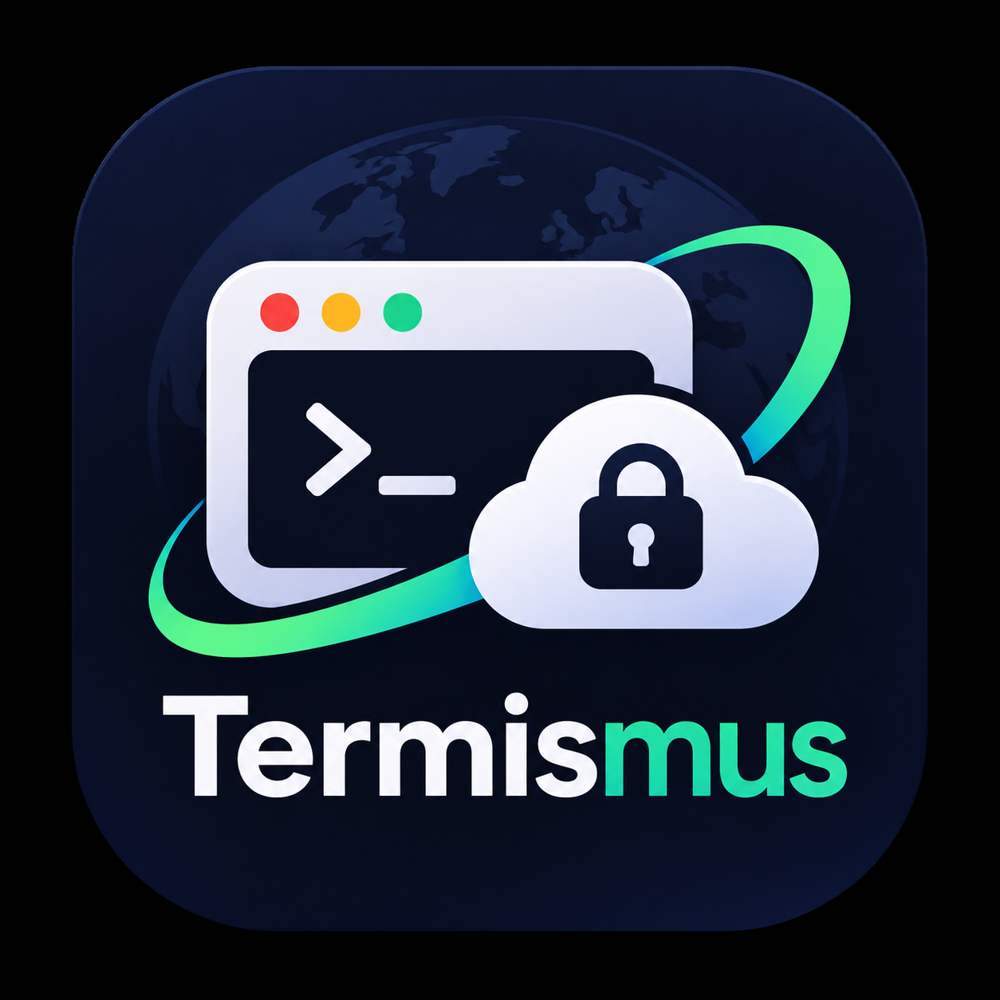

<div align="center">



# TERMISMUS

**Encrypted SSH vault · embedded terminals · SFTP browser · one-click backup**

[](https://github.com/mktr-id/termismus/releases)
[](https://tauri.app)
[](LICENSE)
[](https://www.rust-lang.org)

</div>

---

TERMISMUS is a **local-first SSH host manager** for Windows. All credentials live in an AES-256-GCM encrypted vault — never plain text, never in the cloud. Open SSH sessions stay embedded in the app with full xterm.js rendering, and a built-in SFTP browser lets you transfer files without leaving the window.

## Features

### 🔐 Encrypted Vault
- **AES-256-GCM** encryption with **Argon2id** key derivation
- Master password required to unlock — never stored anywhere
- Vault is re-verified before every write — no silent corruption
- Backup bundles vault + SSH keys into a single encrypted `.tmb` file

### 🖥️ Embedded SSH Terminals
- Full PTY sessions via **ConPTY** — real terminal, not a shell wrapper
- **Tabbed** view for sequential work, **Grid** view for parallel sessions
- Drag & resize each grid pane freely with interact.js
- Password auto-typed on `password:` prompt — or use key-based auth

### 📂 Dual-Pane SFTP Browser
- Browse local and remote filesystems side by side
- Upload & download via **SCP** with auto-password
- Double-click to navigate folders; Up to go back
- Remote defaults to `/home/{user}` on open

### ⌨️ Command Palette  
- **Ctrl+K** launches the quick-open overlay
- Search hostname, label, user, or group
- Arrow-key navigation; `Ctrl+Enter` to SSH, `Ctrl+Shift+Enter` for SFTP

### 💾 Backup & Restore
- Native **Save/Open file dialogs** — choose your own path
- Backup includes all `~/.ssh/` files (private keys, known_hosts, config)
- Restore recovers both hosts and key files atomically

### 🎨 Frameless Aesthetic UI
- Custom window chrome — drag area, minimize / maximize / close
- Icon toolbar with hover tooltips
- Side-panel editor with **800ms auto-save** debounce
- Host cards grouped by group, with SSH / SFTP / Edit quick actions

## Screenshots

> _Coming soon — see [releases](../../releases) for the installer_

## Installation

Download the latest release from the **[Releases](../../releases)** page:

| Package | Description |
|---------|-------------|
| `TERMISMUS_x.x.x_x64-setup.exe` | NSIS installer (recommended) |
| `TERMISMUS-portable.zip` | Portable — no install needed |

## Build from Source

### Prerequisites

| Tool | Version |
|------|---------|
| [Rust](https://rustup.rs/) | 1.75+ |
| [Node.js](https://nodejs.org/) | 18+ |
| [pnpm](https://pnpm.io/) | 8+ |

```bash
git clone https://github.com/mktr-id/termismus
cd termismus
pnpm install
pnpm tauri build
```

> **Note:** The release profile uses `lto = false` and `codegen-units = 16` to avoid OOM on systems with ≤16 GB RAM during the link step. Full LTO shaves ~10% off binary size but needs 20+ GB available during link.

### Dev mode (hot-reload frontend, debug Rust)

```bash
pnpm tauri dev
```

## Architecture

| Layer | Technology |
|-------|------------|
| App framework | Tauri 2 (Rust + WebView2) |
| Frontend | Vanilla HTML / CSS / JS |
| Terminal renderer | [xterm.js](https://xtermjs.org/) + FitAddon |
| PTY backend | [portable-pty](https://crates.io/crates/portable-pty) (ConPTY) |
| Encryption | `aes-gcm` 0.10 + `argon2` 0.5 |
| SFTP | One-shot SSH PTY sessions + `scp` |
| File dialogs | [rfd](https://crates.io/crates/rfd) |
| Grid drag/resize | [interact.js](https://interactjs.io/) 1.10 |

## Vault Format

```
vault.bin = MKTRV1 | salt(16) | nonce(12) | AES-256-GCM( JSON(hosts[]) )
```

Key derivation: `Argon2id(master_password, salt)` → 32-byte key.  
The vault is re-read and decrypted before every overwrite — wrong password = no write.

Backup format (`.tmb`):
```
TMBB01 | salt(16) | nonce(12) | AES-256-GCM( JSON({ hosts, ssh_files }) )
```

## Data Locations

| Data | Path |
|------|------|
| Vault | `%APPDATA%\MKTRVault\vault.bin` |
| SSH keys (read) | `%USERPROFILE%\.ssh\` |
| Backup output | User-chosen path via native dialog |

## Contributing

Pull requests are welcome. For large changes, open an issue first to discuss what you'd like to change.

```bash
# Run clippy before committing
cargo clippy --manifest-path src-tauri/Cargo.toml -- -D warnings
```

## License

[MIT](LICENSE) © 2026 MKTR
